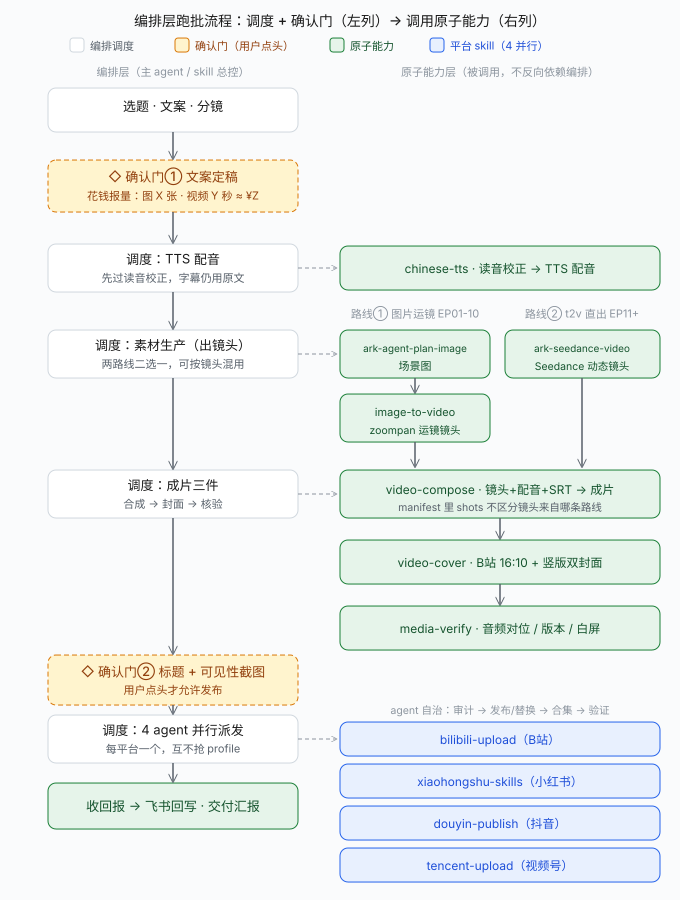

# tangshi-pipeline — 唐诗300首AI短剧 双版本生产与发布

> ✅ 状态：本机实测通过（2026-09-29，EP01 双版本成片+三平台实发、EP02 读诗版、批量脚本泛化、极空间同步 83 文件回读一致）

## 项目坐标

- **飞书表**「开发项目」：base `{{FEISHU_BASE_APP}}` / table `{{FEISHU_TABLE}}` / 本项目记录 `{{FEISHU_RECORD}}`（项目名「唐诗300首AI短剧」）。读写按 skill `feishu-bitable`；更新进度/备注后必须读回验证。
- **交付包**：会话工作目录下 `tangshi-duanju-w1/`，结构见包内 `README.md`。
- **极空间备份**：`{{NAS_DELIVERABLE_DIR}}`（团队空间/公共分组）。WebDAV 断网时用 zspace-cli（见文末同步节）。
- **系列名**：《一首诗，一出戏》｜ 系列圣经与选片标准见 `00-样片诗单.md`。

## 资产库（2026-10-03 建成，分镜/生产前先查这里）

| 类型 | 位置 | 用法 |
|---|---|---|
| **人物** | `w1/02-角色资产/`（人设卡+全身基准图） | 有人物出镜先查卡；人物镜头优先 i2v 锁首帧 |
| **场景** | `w1/03-场景资产/`（README 索引 + **SC-01~09 场景卡** + ref/ 基准图） | 分镜画面写 `场景卡 SC-0x` 即引用；生图 = 卡内**标准 prompt 块**打头 + `[主体变化]` 插槽替换，只改前段不改风格后缀 |
| **视觉/镜头/文案配方** | `w1/04-视觉配方/`（style-bible.md / shot-library.md / copy-template.md） | 色板 ID 与构图术语进分镜；运镜与 t2v 动势从 shot-library 选（标「派生待验」的首用需抽检）；新集文案从 copy-template 填槽 |
| **读音规则** | skill `chinese-tts` 内 pinyin_fix.py（40+ 规则） | 配音前 check+pinyin 双跑；新误读必须回写规则表 |
| **复盘方法** | skill `tangshi-data-review`（六脚本+报告模板） | 每批发布后按其节奏采样与出报告 |
| **外部技法弹药** | `w1/tasks/T144/report.md`（prompt/一致性/每句一镜）+ references `research-cost-t195.md`（**4折已死回刊例；S镜头480p+本机超分→单集¥4.26→2.92；资源包零折扣勿买；draft=额外计费**）+ `research-beauty-t196.md`（**xfade转场/墨滴遮罩/ASS逐字竖排本机实测PASS；mixkit直链BGM；fps三层25/24/30不一致先修**） | 导演式 prompt 结构、光五维、调色四件套、每句一镜——见 EP51-60 规划美学包；升级决策先读两份 research |

**铁律**：全系列风格后缀以 `02-角色资产/崔护-人设卡.md` 与场景卡内**逐字一致的后缀为唯一锚点**（`写实国风电影感，唐代，柔和自然光，浅景深，胶片质感，9:16竖屏，高细节，无文字水印`）；prompt 只允许改前段的时段/光线/色板词，后缀永不改。

## 编排流程图（本 skill = 全流程编排，只做调度与确认门）



- 浏览版 PNG：`references/orchestration-flow.png`（1360×1800，源文件 `orchestration-flow.svg`）
- 图中左列=编排层（选题→门①报价→配音/素材/成片调度→门②发布确认→4 agent 并行→回写），右列=被调用的原子 skill；素材生产分**路线①图片运镜（EP01-10）**与**路线② Seedance t2v（EP11+）**，在 `video-compose` 汇合、可按镜头混用
- 发布段（确认门②之后）的细节手册在 skill `quad-platform-publish`

## 双版本规格（已定稿，勿改）

| 版本 | 时长 | 结构 | 关键参数 |
|---|---|---|---|
| **A 读诗版**（读整首诗） | 25-27 秒 | 题卡→四句连读→全诗字卡+尾钩 | 语速=报幕同款自然语速（禁「慢速/朗诵腔」提示词）；**相邻配音间隔同集统一（2026-10-02 用户指定）：题卡→段1、段1→段2、段2→尾钩等所有 gap 取同一值，差 ≤0.1s**——排轴 `gap=(目标总长−语音总长)/间隔数`；**design gap 默认 1.5s（EP33 起，EP31-32 曾用 2.4、EP32 用户反馈句间偏长；实测≈design+0.3~0.7 且合成前先做 wav 边缘静音归一头0.05/尾0.25）**，须留 ≤3.2s 静默余量；总长与静默冲突时调语速不调 gap；禁 EP11 式 5s 固定大槽；竖屏 720×1280 |
| **B 故事版**（根据诗讲故事） | 60-90 秒 | 前3秒钩子→三幕→点诗→下集钩子 | **最大静默 ≤3.2s**（astats 数值核验）；配音角色：旁白茉莉/男白桦/少女冰糖；**全体配音语速偏快（2026-10-03 用户指定，EP41 起：所有 B 槽 context 统一带「整体语速偏快、节奏紧凑」，fit 循环用 gap 把总长抬回 57-71s）** |

- 命名：`EPxxA-<诗题>-读诗版.mp4` / **`EPxx-<诗题>-故事版.mp4`**（2026-10-03 用户指令：B 版一律用**诗题**，禁剧名——EP31-40 曾误用剧名已全部改正；「故事版」后缀 2026-10-02 起废止「样片视频」；EP01-30 历史文件不回改）；目录 `0x-EPxx-<诗题>/`。**平台标题（含 B 版）一律用诗题**（2026-10-01 用户指定，EP15 起；本地文件名同步此规则），细则见 `quad-platform-publish` 文首规则。
- **发布节奏（2026-10-01 数据复盘定稿，EP21 起执行）**：
  - **每天 1-2 条、间隔 ≥4h、铺满 24 小时窗口**（禁几小时内连发十几条——同质内容互抢推荐池，实测会让整体表现一起塌掉）
  - 同集 A 先 B 后、间隔 **30-60 分钟**；A 描述挂 B 合集链接，主动做合集连播；集与集间隔半天到一天
  - **首发后 0-24h 是生死线**（越过后条均播放按数量级衰减）：置顶评论、主页推荐、社群分享、A 引 B 全部塞进首日
  - 平台优先级：**P0 视频号**（主战场，量占三平台近半）→ **P1 抖音**（保量+补互动，先不投流）→ **P2 B站（EP21 起只发 A）**（无自然分发，仅留诗名+作者搜索长尾，排最后不复核）
  - 互动前置（发布 agent 必做）：视频号 A 版置顶「关注追更」评论；抖音 A 版评论区置顶提问（背诗打卡）+ 置顶 B 版链接
  - **产能铁律（多轮实测定稿）**：单日条数越多、次日冷启动越差，**超量后哪怕拆成两波也救不回第二波**——**单平台单日 ≤20 条、单波发完、主波 12:00–15:00、禁 22:00 后晚波（晚波实测全地板）**；进池判定必须锚定同一**龄期窗**（固定阈值跨龄期不可比）；**慢启动条目 30h 后不再补量**（30h 是补量硬截止）；采样制度：**T+6h/T+24h 必采、发布后 1h 内置顶评论**；视频号 cookie 约 2-3 天失效（有头扫码 7min 回存）
  - **衰减终值（实测）**：24-48h 单段按数量级衰减、进池组继续衰减到接近地板，48h 后基本地板化 → 24h 动作窗口不变，**30h 是补量硬截止**（慢启动 24h 补量对普通条目不成立）
  - 以上结论来自五轮真实数据复盘（原始数据表与逐轮推理**未随本包发布**）。本文件只保留提炼后的可执行规则；要复现同样的口径，用 skill `tangshi-data-review` 的采集脚本对自己的账号重跑。

## 选片权重与 EP21-30 规划（2026-10-01 数据复盘修正，选新集前必读）

样片诗单五条标准（`00-样片诗单.md`）按 EP01-20 播放数据重排权重：

| 标准 | 权重 | 依据 |
|---|---|---|
| ② 画面感强（奇观/边塞/夜景/冲突） | **第一** | 边塞/夜景类的播放比长诗抒情高一个数量级 |
| ④ 名篇自带搜索流量 | **第二，须与②联用** | 强区几乎全是名篇；金缕衣/闺怨也是名篇但画面弱→无效 |
| ① 自带故事结构 | 保持，不加码 | A/B 播放基本打平，故事结构本身未带来播放优势 |
| ③ 题材/诗人多样 | 降为约束条件 | 多样性本身不产生播放，只防同质化 |
| ⑤ 公版原文 | 不变 | — |

- **池子**：优先池=边塞/送别/夜景/咏史冲突 **且诗人未出场**；降级池=劝世/闺怨/纯抒情（EP08-10 弱区），非做不可就排批末；谨慎池=长诗变体**每批最多 1 集**且 A 版压回 30s（只读名句段）。
- **时长不是变量**（长短与播放无明显相关）：A 保持 21-30s、B 保持 57-71s，优化位在前 3 秒钩子与发布节奏，不在秒数。
- **视频号描述首行带名句**（唯一有量的平台，单独优化搜索权重）。
- 规划文件：第一批 `00-样片诗单.md`、EP13-20 `00-EP13-20规划.md`、**EP21-30 `00-EP21-30规划.md`**（选集与状态以该文件为准）。
- 复盘方法（采集脚本、龄期分档口径）见 skill `tangshi-data-review`；本包不含原始数据表。

## A 读诗版生产流程

1. **建目录** `0x-EPxx-<诗题>/`，分镜由脚本自动生成 `EPxxA-读诗版-分镜.md`。
2. **TTS 6 条**（tts_speech，茉莉，output 存 EP 目录）：
   - `voA0-题卡` context=`诗题报幕，中速偏快，自然流畅，干净利落，不拖音`，文本=`<诗题>，唐，<作者>。`
   - `voA1~A4-句N` context 必须原文：`与节目报幕完全相同的正常语速，像日常自然把这句诗读出来，干净利落，不要朗诵腔，不要拖长尾音，不要字与字之间停顿`
   - `voA5-尾钩` context=`节目收尾预告：前半句「一首诗，一出戏」语速偏快、轻快连读一带而过，后半句中速明快亲切，不拖沓`，文本=`一首诗，一出戏。下集，<下一首>。`（末集用`关注我，下一首见。`；**「一首诗一出戏」要快读**——2026-10-03 用户指定，EP41 起生效）
3. **场景图 5 张/首**（image_gen，size `864x1536`，quality medium）：`k0-题卡`（诗境全景，也用作 S6 尾镜）+ `k1~k4` 逐句画面。风格后缀每条必带：`写实国风电影感，唐代，柔和自然光，浅景深，胶片质感，9:16竖屏，高细节，无文字水印`；**不要把文字画进图**。图名清单写进 `build_read_batch.py` 的 `EPS[].images`。
4. **批量合成**：`python build_read_batch.py`（包根目录）——自动测 wav 时长→排时间轴（0.8s 句间隔）→写 SRT（连续字幕）+分镜 md→ffmpeg 运镜合成；**缺图的 EP 自动 SKIP**，配额恢复后重跑即补齐。
5. **图片配额 403**（subscription_quota_exhausted，周重置）：TTS 不受影响，先出音频/SRT/分镜，配额恢复补图重跑。

## B 故事版生产流程

1. 写 `EPxx-分镜脚本.md`（镜头表/台词配音清单/剪辑备注），台词覆盖检查：**任意 3 秒窗口必须有配音或明确设计的留白**。
2. TTS 按分镜配音清单逐条出（角色音色见规格表），全部产出后测时长。
3. 合成：**调用原子 skill `video-compose`**（manifest JSON = SEQ/AUDIO/total/srt，替代手写 build_epxx.py；本目录旧 `build_ep*.py` 仅作历史参考）。zoompan 静态镜头走 `image-to-video`。
4. SRT 长句手动断行（每行 ≤14 字）；竖屏样式 `FontSize=10, MarginV=90`（video-compose 内置；**2026-10-01 上移**防平台 UI 遮挡，参考抖音截图位置；横版 18/20 溢出裁切已踩坑；字卡行数多时按 video-compose SKILL 的行数公式降 MarginV/字号）。
5. 合成后验收：`media-verify` astats + brightness（见「质量核验」）。

### 原子能力分工（2026-09-30 起，本项目只做编排）

| 环节 | 原子 skill |
|---|---|
| 场景图（Plan 通道） | `ark-agent-plan-image` / `image_gen` |
| 场景图（标准按量通道） | **`ark-seedream-image`** |
| 图片→运镜镜头 | **`image-to-video`** |
| t2v 直出镜头 | **`ark-seedance-video`** |
| 分镜+配音+SRT→成片 | **`video-compose`** |
| TTS 读音校正 + 音色/context | **`chinese-tts`** |
| 封面（B站 16:10 + 竖版） | **`video-cover`** |
| 音频对位/版本/白屏核验 | **`media-verify`** |
| 四平台发布 | `quad-platform-publish`（内含 4 平台各自 skill） |

### 生产节奏与编排优化（2026-10-01 EP20 实测复盘 → EP21 起标准时序 ≤25min/集，质量门全保留）

**EP20 实测时间线**（2026-10-01 CST，产物 mtime + actor spawn/notification 记录还原）——端到端 **16:16:50 → 17:16:07 = 59.3min/集**，纯生产只占 7.1min（12%），**88% 花在发布等待与主线程同步 wait**：

生产段（主线程）：

| 时段 | 阶段 | 耗时 |
|---|---|---|
| 16:16:50–16:17:27 | TTS 10 条（A×4+B×6） | 37s |
| 16:18:19–16:20:18 | 场景图 k0–k5 ×6（串行） | 2.0min |
| 16:20:19–16:22:38 | t2v ×1（create→poll→download 串行） | 2.3min |
| 16:22:44–16:23:09 | zoompan 镜头 ×9 | 25s |
| 16:23:25–16:23:36 | manifest + video-compose A/B | 11s |
| 16:23:55–16:23:57 | 抽帧 + 双平台封面 ×4 + astats 核验 | ~30s |

发布段（16:24:10 写 `epXX-copy.md` → 16:24:27 一次 spawn 3 agent 并行）：

| Agent | 起止 | 耗时 | 关键等待 |
|---|---|---|---|
| B站 | 16:24:27–16:34:36 | 10.2min | biliup 21566 → 网页回退 |
| 视频号 | 16:24:27–16:35:14 | 10.8min | 发布自动错归修复 |
| **抖音** | 16:24:27–17:11:51 | **47.4min** | `.dy-profile` 与 EP19 agent 争用 12min（16:30–16:42，16:42 克隆解耦）+ B 撞车重跑 2.5min + 封面 60s 传播 ×2 + **延迟审计空转 10.3min**（16:54–17:04） |
| 主线程 | `wait` 最慢 agent → 飞书回写 | 17:11:51→17:16:07 | 4.3min |

上游跨集损失：EP19 抖音 agent 14:20 中途被取消 → 主线程 14:31–16:16 空转 **105min** 才开 EP20。

**根因**：① 主线程同步 `wait` 最慢 agent，后一集生产被阻塞；② 抖音 15min 延迟审计 + 封面 60s 传播落在关键路径；③ 多 agent 共享 `.dy-profile`/浏览器 profile 互杀；④ 文案内联进 spawn prompt 触发 **ContentFilterError** 中断（EP19/20 实发，EP20 起改外置文件）；⑤ 生产串行 create→poll + 主线程 ~10 次工具 roundtrip。

**优化清单（4 层，合计 −30~35min → ≤25min/集）**

① **主 agent 编排**（−15~20min 关键路径）
- 生产与发布重叠（最高优先）：spawn 3 agent 后主线程**立即开下一集生产**，结果靠 notification 收割，飞书两集一批回写（−5~8min）
- 非关键路径不阻塞：抖音延迟审计、合集复核、终审移出发布 agent，由主 agent 下一集收尾时补跑（−10min）
- 并行度上限 4（3 发布 agent + 1 生产）；同平台资源每 agent **一次性预克隆**（`.dy-profile-epXX`），禁止共享互杀（−12min 争用）
- 超时/接管预案：agent 卡 >5min 先 **actor send 续命**（带 `progress.md` 摘要续写），5min 无响应才 spawn 接续，禁整只重跑；agent 被取消立即接续（防 EP19 式 105min 空窗）

② **每阶段工具化**（−3~5min）
- 生产单脚本 runner：pinyin audit→TTS→图→t2v→zoompan→compose→verify→cover 一条命令排队（原子 skill 不变，省主线程 ~10 次 roundtrip）（−2~3min）
- t2v 全镜头先并发 create 再统一 poll；场景图 6 张并发（−2~3min）

③ **三平台并行 + 文案外置**（EP20 已生效，保持不回退）
- 文案先落 `epXX-copy.md`，spawn prompt 只给路径（lean）→ 降 ContentFilterError（每次中断 −5~15min）
- 三平台并行是基线收益：10.8min vs 串行 ~31min（−20min，勿回退成串行）

④ **砍非必要环节**（−3~5min）
- 抖音 15min 延迟审计降频至每 3 集一次，或移到下一集收尾（−10min，已计入①）
- 封面 apply 后 60s 等待改为与 B 发布 / mix 并行执行（−1.5min）
- B站 审计→上传→回读→封面字节比对→合集 add→复核合并成一条脚本一次跑（−2~3min）；astats/brightness 只在合成后跑一次，不逐镜头

**EP21 起标准时序目标（≤25min/集）**

| 时点 | 动作 |
|---|---|
| T+0 | 生产单脚本启动（图/t2v 并发） |
| T+5 | 成片+双封面+`epXX-copy.md` 就绪 → spawn 3 发布 agent；**主线程同时开下一集生产** |
| T+5→T+23 | 三平台并行发布（抖音 ≤18min：预克隆 profile、延迟审计移出、封面 60s 等待并行） |
| T+23→T+25 | 收割 3 agent + 合集终验 + 飞书回写（两集一批，可再与下一集重叠） |

超 25min 即触发接管：actor send 续命 → 仍无响应换 spawn + `progress.md` 接续，不等、不重做已完成步骤。

### 成本基线与降本（2026-10-01 实测）

- 当前边际成本 ≈ **¥4-5/集**（flash 图 6×0.12 + 720p t2v ~7-14s 刊例 ¥3.5-7）
- **480p t2v 实测省 53.5%**（5s：50,638 vs 108,900 tokens，¥1.16 vs 2.50 刊例）——B 版 t2v 可切 480p，但 video-compose 会升采样到 720p，**先抽检 1 条画质再批量**；A 版纯 zoompan 本来 0 视频成本
- 纯路线①的 B 版 = 视频 0 成本（EP01-10 全史实）；动作戏才用 t2v
- 方舟**资源包/预付折扣**值得在控制台看一眼（未验，通常有折）
- 换外部通道（通义万相/可灵/即梦）：画风一致性会破 + 重接入成本，除非确认省 ≥40% 否则不切（待验清单，搜索插件恢复后再查价）

### 路线选择与人物形象一致性（2026-09-30 定稿）

**路线选择**：默认路线①（省钱、静态意境/题卡够用）；**强动作/速度感/情绪张力镜头用路线②**（t2v 直出或 i2v）；同一条成片两条路线可按镜头混用（`video-compose` 的 manifest 不关心来源）。

**一致性铁律（有人物出镜必守）**：

1. 每首有人物的诗先建 **人设卡 + 全身基准图**（`02-角色资产/`，模板见崔护卡；跨集复用同角色必须带基准图控图）
2. **人物镜头优先 i2v 锁首帧**（已实测）：seedance `content` 里放 `{"type":"image_url","image_url":{"url":"data:...或http..."}}` + text → 首帧=基准图/关键帧，MAD 9.7 实测锁定（见 ark-seedance-video §i2v）；**纯文生 t2v 只用于无人物空镜**
3. 两路线共享首帧：路线①定妆关键帧 → 抽帧 → 喂路线② i2v 加动势 = 形象一致 + 运动兼得
4. **路线① t2i 不承诺人脸一致**：Plan 通道参考图实测 `input_images=0`（图被忽略）、标准通道 seedream 未开通、即梦图生图需 VIP——所以人物特写禁止靠多次 t2i 重画；同图多镜复用 + prompt 内嵌人设特征词（发型/服装/年龄，从人设卡抄）
5. i2v 只锁**首帧**，运动中段可能缓慢漂移 → 发布前 media-verify 抽帧 + 人设特征速检

## 视频生成方式：Seedance t2v（2026-09-30 EP11 起，成片镜头由「图片运镜」升级为「AI 视频」）

EP01-10 用「场景图 + ffmpeg zoompan」出镜头；**EP11 起镜头直接用火山方舟 Seedance 文生视频（t2v）**，动态感强（跟拍/拉升/横移），build 脚本只做拼接+配音对时+烧字幕（模板 `13-EP11-早发白帝城/build_ep11a.py` / `build_ep11b.py`，SEQ 直接列 mp4 分镜）。

- **通道**：火山方舟标准 API，key 存 `{{ARK_API_KEY_FILE}}`（env `ARK_STD_KEY`，**不入 skill/记忆明文**）
- **创建**：`POST https://ark.cn-beijing.volces.com/api/v3/contents/generations/tasks`，body：
  `{"model":"doubao-seedance-2-0-mini-260615","content":[{"type":"text","text":<镜头prompt>}],"generate_audio":false,"resolution":"720p","ratio":"9:16","duration":<5-14秒>,"watermark":false}`
- **轮询**：`GET /tasks/{id}` → `status=succeeded` 后取 `content.video_url` 下载（`usage.completion_tokens` 此时已返回）；`failed` 不计费
- **prompt 配方**：一句镜头动作（推近/跟拍/拉升/横移）+ 画面要素 + 统一风格后缀 `，古风写实电影感，竖屏9:16构图，画面无水印`；文字不进画面
- **可复用脚本**：`%TEMP%\ark_ep11a_vids.py` / `ark_ep11b_vids.py`（批量 CLIPS 列表 + create/wait/download + 跳过已存在 >500KB 的成品，断点重跑安全）
- **token 实测公式**（720p/9:16/mini）：`completion_tokens = 21600 × 秒数 + 900`；用量与估价查询：`GET /tasks/{id}` 看 `usage`
- **成本**（2026-09-30 官网刊例）：`doubao-seedance-2.0-mini` = **23 元/百万 token**（≈0.5 元/秒@720p）；限时 4 折（企业用户，至 2026-10-07）≈0.2 元/秒。**EP11 实账**：13 条（A 5 + B 7 + 测试 1）91 秒 = **1,977,300 tokens ≈ ¥45.5 刊例 / ¥18.2 折后**
- 同价位带：`2.0-fast` 37 元/百万（75 折限时）、`2.0` 46 元/百万、`2.5` 70 元/百万——剧情镜头用 mini 性价比最高
- 更完整的独立用法见 skill **`ark-seedance-video`**（原子生成一条视频）

### TTS 读音核查（2026-09-30 用户指定，配音前必做）

- 多音字逐句过一遍：**朝=zhāo（朝辞白帝）、还=huán（一日还/还给了）、重=chóng（万重山）、骑=jì（一骑红尘）、教=jiào（悔教夫婿）**
- **TTS 输入文本用同音字替换**（朝→招、还→环、重→虫）保证发音必然正确；字幕/SRT 仍写原字。context 风格指令管不了读音，别指望它纠多音字
- EP11 教训：`朝辞白帝彩云间` 直接丢给 TTS 念成 cháo，发布前才发现→5 条配音重合成+两条成片重建+已发平台替换。**流程入口**见 skill `quad-platform-publish` §发布前读音核查

## 质量核验（必做）

> 首选：原子 skill **`media-verify`**（`astats` 分窗能量 / `audio-ncc` 版本比对 / `brightness` 白屏，三条命令覆盖下述全部场景）。以下是底层原始命令备查。

**字幕标点规范（2026-10-03 用户指出，EP51 起）**：A 版 SRT 诗句**第二行（双句成段收句）末尾必须加句号**（如「不遣胡儿匹马还。」），行内逗号照旧；题卡行（`诗题 · 唐 作者`）与 B 版台词不加此约束。出片前抽帧 OCR 查句号。**EP41-50 已发布版本缺句号不回改（用户裁决 2026-10-03）。**
**字幕样式定版（2026-10-04 用户选定 EP51A-书法试验2）**：A 版默认用**样式1=华文行楷48+白字+墨褐#2B1D0E描边3px+墨色渐变底条**（单层禁叠字）；参数与渲染旁路见 `w1/04-视觉配方/subtitle-styles.md`；样式2（米白赭褐素雅版）为参考资产。B 版暂维持原样式。
**TTS 底噪降噪铁律（2026-10-04 用户反馈沙沙声，EP59 起强制）**：TTS 合成 wav 固有 ~-46dB 底噪，慢语速长段+边缘归一重建会把它拼进近静音区（EP43+ 可闻，真静音占比 40%→21%）→ **每条 wav 归一前必过 `afftdn=nr=12:nf=-40,agate=threshold=0.01:ratio=20:attack=2:release=150`**（实测静音段 -46→-74dB、语音仅损 0.3dB），归一后抽检静音 astats ≤-70dB。EP51-58 存量已批量降噪替换；EP43-50 已发布不回改（除非用户另行指令）。

```powershell
# 音频对位+静默窗口数值核验（配音段应 -18~-24dB，空档应 -inf）
ffmpeg -ss <s> -t <dur> -i video.mp4 -map a -af astats=metadata=1 -f null - 2>&1 | Select-String "RMS level dB"
```

- **Read 工具会返回错图/缓存图**（会话级 bug，已两次实锤：同哈希文件两次读出不同图）：视觉核验后用 `Get-FileHash` 比对确认是文件问题还是读取问题；下结论前先哈希。
- **seek 修正（2026-09-30 实测推翻旧结论）**：本机 ffmpeg 把 `-ss` 放 `-i` 之后会被**静默忽略**（astats 输出与不 seek 逐位相同）——分窗核验/抽帧定位一律用 **input-seek `-ss N -i file …`**；核验前先用已知静默区（片尾无配音处）探针自证 seek 生效，再信读数。

## 三平台发布（总控手册见 skill `quad-platform-publish`；**当前为三平台模式——小红书自 EP14 风控起按用户指令停发**，以下是本项目增量实录）

- **B 站**：cwd 必须 `%USERPROFILE%\.bilibili`；`--line bda2`；本系列分区 **`--tid 228`（知识·人文历史）**，`--copyright 1`；封面 `ffmpeg -vf "crop=864:545:0:400,scale=1146:717"` 从方形关键帧出。已发：EP01-A = `BV0000000000`。
- **小红书**：模板 `{{WORKSPACE}}\sample-diary-map\publish-xhs.js`（persistent profile `.xhs-profile` headless）。改 3 处再跑 `publishnow`：`TITLE`（≤20字）、`BODY`（分点+emoji+结尾#话题）、note-manager 验证用的 `indexOf('<标题片段>')`；`VIDEO_PATH` env 传视频。成功判定=笔记管理出现标题行（状态「审核中」）。
- **抖音**：模板 `dy-publish.js`（同目录）。env：`DY_HEADED=1`、`DY_PROFILE=...\.dy-profile`、`DY_VIDEO`。**视频路径必须纯 ASCII**（.cmd 用 ASCII 编码写会吞中文路径 → 先 Copy-Item 到 `%TEMP%` 再传）。登录过期加 `DY_WAIT_LOGIN=1`（开窗扫码，≤12 分钟）。流程：WMI `Win32_Process Create` 起后台（**必须 `ShowWindow=0` 静默启动，否则 cmd 黑窗闪桌面**：`Invoke-WmiMethod -ArgumentList @(cmd, $null, $si)`，`$si.ShowWindow=0`，细节见 feishu-bitable skill）→ 轮询 `dy.log` 至 `WAITING_USER_CONFIRM` → 写 `dy-confirm.txt` → 等 `PUBLISH_SUCCESS`（脚本自动勾 AI 声明）。`DY_HEADED=1` 的浏览器窗口是抖音风控必需、无法静默——开窗前告知用户。已发：EP01-A。
- **发布前**：标题+可见性给用户确认一次（用户已批量授权时可一条消息覆盖三平台）。
- **发布后写回飞书**：备注追加 `【三平台发布 <日期>】` 段（BV/笔记标题/状态），JSON 文件 **UTF-8 无 BOM**（`[IO.File]::WriteAllText` + `UTF8Encoding($false)`，PS5.1 `Set-Content -Encoding UTF8` 带 BOM 会被 lark-cli 拒）；进度回读验证。

## 美学升级包 v1（2026-10-07 新增，EP81 试点）

> 来源：T195/T196 调研（本 skill references 目录下 research-cost-t195.md 与 research-beauty-t196.md）+ 本机 21/21 实测；资产与测试脚本在 `references/beauty-kit/`（_test_trans.py / kara.ass / vert.ass）。**本节为纯新增，与既有定版（书法字幕样式1、色板、运镜库）叠加使用，不替换任何旧规格。**

1. **段间转场（零成本）**：合成时段落间用 ffmpeg `xfade`——常规 `dissolve`/`wipeleft`，仪式感处 `fadewhite`；实测 4/4 PASS。注意转场重叠会吃时长：manifest 排轴时按重叠时长补偿（`_test_trans.py` 有参数样例）。
2. **墨滴晕开转场（零成本，特别集用）**：Pillow 噪声阈值遮罩 → `alphamerge`+`overlay`，本机出片实测 PASS（T196 `ink_t*.png`）。
3. **诗句逐字显现（零成本）**：ASS karaoke `{\k}` + `SecondaryColour` 全透明（未显形无描边残留）；时间按字数估。`kara.ass` 为验证模板；video-compose 接入≈5 行改动（SRT→ASS 分支），**EP81 试点先以「独立 ASS 覆盖渲染」路径跑，不改 video-compose 核心**。
4. **竖排题卡/印章（零成本）**：ASS 逐字 `\N` 换行（**不用 `<br>`**），华文行楷 STXINGKA.TTF 本机已装；`vert.ass` 为模板；用于 A 版题卡特别版或彩水墨特别篇。
5. **fps 统一 30（零成本，先修再谈补帧）**：现状 25（zoompan 渲染）/24（compose manifest）/30（平台）三层不一致——zoompan `--fps 30` 直接重渲即可，compose manifest fps 对齐 30；RIFE 补帧暂缓，Topaz 不值。
6. **S 镜头降本：480p i2v + 本机超分（RTX 4060）**：720p i2v 2.50 → 480p 1.16 + RealESRGAN_x4plus 本地超分（免费）→ 单集 ¥4.26→≈¥2.92。**先 1 条抽检**（逐帧闪烁/细节），通过才批量；animevideov3 偏动漫慎用于写实古风。
7. **BGM 轻底垫试点（合规路径）**：音源白名单=mixkit 直链 mp3（Free License）、freesound CC0、incompetech CC-BY；**FreePD 已关站勿引用**；B 版垫入配方 `loudnorm=I=-24:TP=-2:LRA=7` 两段式 + 低增益，**先 1 集给你听感裁决**；中国风公版仍缺，未拿到满意音源前维持无 BGM。
8. **彩水墨特别篇（片种隔离）**：实证 prompt 已在 research-beauty-t196.md（「彩色鎏金水墨风格」「朱砂红主调」）；只做每批 1 集特别篇，**只换风格段+色板两变量**，五段骨架/光五维/书法字体锚点全复用；平台标题加「特别篇」标记。
9. **成本底线提醒**：4 折已于 10-07 14:00 到期回刊例 23 元/M；资源包 t2v 零折扣勿买；draft=额外计费暂缓；普惠季 50 万免费 tokens 可领。

### 美学升级包 v1 · EP81 试点回填（2026-10-08 七项全 PASS，用户验收通过 → 成为 EP82-90 标准规格）

> 试点样本：`w1/83-EP81-望天门山/`（A 23.10s / B 60.50s，30fps，¥2.92 命中）；实施脚本在该目录（_compose2/_bgm_mix/_sr_run/_qc_beauty/_qc_kara_px）；SC-11 峡江天门卡已回写。

1. **超分定稿**：`realesrgan-ncnn-vulkan`（GPU Vulkan ~2s/帧）+ realesrgan-x4plus 模型——**CPU realesrgan 47s/帧不可行（本机 torch 全 CPU 版）**；GitHub 直连慢，下载加 `https://gh-proxy.com/` 前缀（67MB 约 30s）；采纳判据=3 帧时序 MAD ratio <1（试点 0.97 无闪烁）；basicsr 1.4.2 与新 torchvision 冲突→`functional_tensor` 改 `functional`。S 镜头链路定稿：**i2v 480p → ncnn 超分 → 用作 S 镜头**，¥4.26→¥2.92。
2. **BGM 混音定稿**：mixkit《A Decade in Beijing》（Mixkit License 免版税，页面存 EP81 `_mixkit_trad.html`）；两段式 loudnorm 目标 **-24.26 LUFS** 后 ×0.45 垫入（底垫≈-30.9 LUFS，比语音低 10-15dB）；实现 `_bgm_mix.py` 可复用。
3. **转场/逐字实参**：xfade dissolve 重叠 0.5s 排轴补偿（边界 meanL 72-83 无闪缝）、fadewhite 白峰 188→80 受控；karaoke 按语音时长均分字数，验收=白字像素单调升（_qc_kara_px 法）；**B 点诗 fadewhite 后的字卡段时长要单独排**。
4. **编码陷阱（必防）**：视频链末端接 `subtitles`/`ass` 时**必须显式 `format=yuv420p`**，否则 libx264 协商 yuv444p High444 平台不认；BGM 混入 `-c:v copy` 会原样继承错误格式，compose 侧一并修。
5. **工具断言**：`_denorm.py` 无参会 glob 根目录空数组也打 OK → **跑降噪必须 assert 非空**；`_gen_bar`/QC 脚本一律 EP 目录 cwd。

## 极空间同步（WebDAV 断网时的标准路径）

```powershell
$py = (Get-Command python).Source   # 系统 Python312，已装 zspace-cli
& $py -m zspace_cli.cli check       # OK 极空间客户端已连接
& $py -m zspace_cli.cli mkdir "{{NAS_DELIVERABLE_PARENT}}" "唐诗300首短剧"   # mkdir = PARENT NAME 两参数
& $py -m zspace_cli.cli up <本地文件> "<远端目录>"                        # 单文件上传，201/OK
& $py -m zspace_cli.cli tree "{{NAS_DELIVERABLE_DIR}}"       # 回读校验（文件数对齐本地）
```

- 走桌面客户端代理 127.0.0.1:13579，跨网段可用；WebDAV（{{NAS_HOST}}:5005）当前网络不通，勿走（详见全局 MEMORY）。
- 上传循环：按本地相对路径逐文件 `up`（目录先 `mkdir`），完后 `tree` 行数与本地 `Get-ChildItem -Recurse -File` 计数比对。

## 生图通道（2026-09-29 实测定论，选通道先看这张表）

| 通道 | 状态与用法 |
|---|---|
| **火山 Agent Plan 直调（首选，已实测）** | `POST /api/plan/v3/images/generations`，model `doubao-seedream-5.0-lite`，size `"2K"`+prompt竖屏→1600×2848，watermark:false，扣 Plan 配额（~17.8k tokens/张）。完整配方见 skill **ark-agent-plan-image** |
| 内置 `image_gen` 工具 | 走**应用订阅周额度**，撞限报 403 `subscription_quota_exhausted`，等重置/升级，与任何 API key 无关 |
| 智谱 CogView 直调 | 备用：`POST open.bigmodel.cn/api/paas/v4/images/generations`，model `cogview-3-flash`，size `864x1536` 实测生效，key 用 `mimocode.jsonc` 的 `open-bigmodel-cn`；**画风与 image_gen 不一致**，混用需先跟用户确认 |
| MiMo API key | ❌ 无生图：models 列表仅聊天/语音，`/v1/images/generations` 404，v2.6-flash 只吐 SVG 文本 |
| 即梦画布 CLI | 登录✅、模型目录✅，但 `canvas create/ls` 服务端 `vip_membership_required`——需即梦 VIP 才能用画布线 |

### 即梦 CLI（dreamina-canvas）

- 二进制 `{{USER_HOME}}\bin\dreamina-canvas.exe`（v1.0.1），Skill 在 `.agents\skills\dreamina-canvas-cli`（含 authentication/recovery/identity/credits references，生图工作流以该 Skill 为准）。
- 登录：`auth login --format json` 出 challenge（verificationUri 内嵌授权码，~15 分钟过期），用 WMI 后台跑 + 日志抓链接给用户点；**进程死掉授权不会落盘**，需重新 challenge（`auth status` 的 `loggedIn:true` 才算数）。
- 生图前必查 `model list --type image` 取 canonical model；积分报价≠授权，超 ceiling 停下问用户。

## 当前进度（以飞书记录为准，此处不重复维护）

- 项目记录：base `{{FEISHU_BASE_APP}}` / table `{{FEISHU_TABLE}}` / `{{FEISHU_RECORD}}`；进度与逐集发布实录全部在该记录「备注」字段。
- 长期待办：① B 版 BGM（剪映包装）② 抖音账号改垂直定位（简介/头像/置顶，放量前置）③ 视频号 T+24h/48h 复测采样（下轮复盘前置）。
